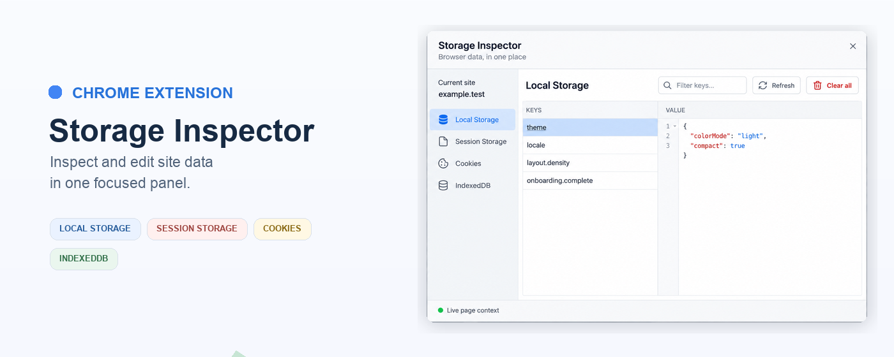
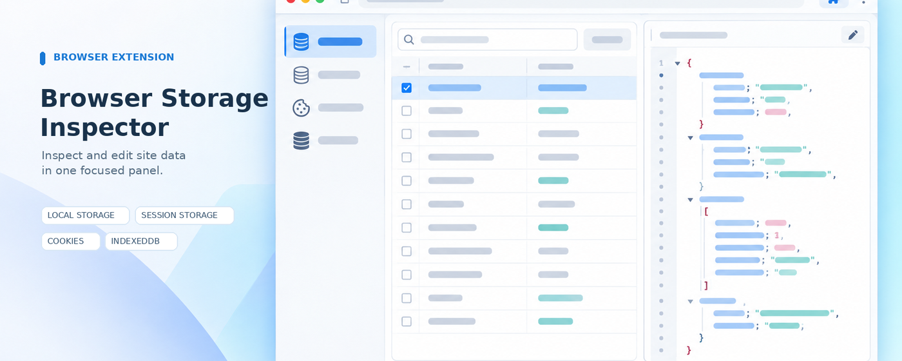
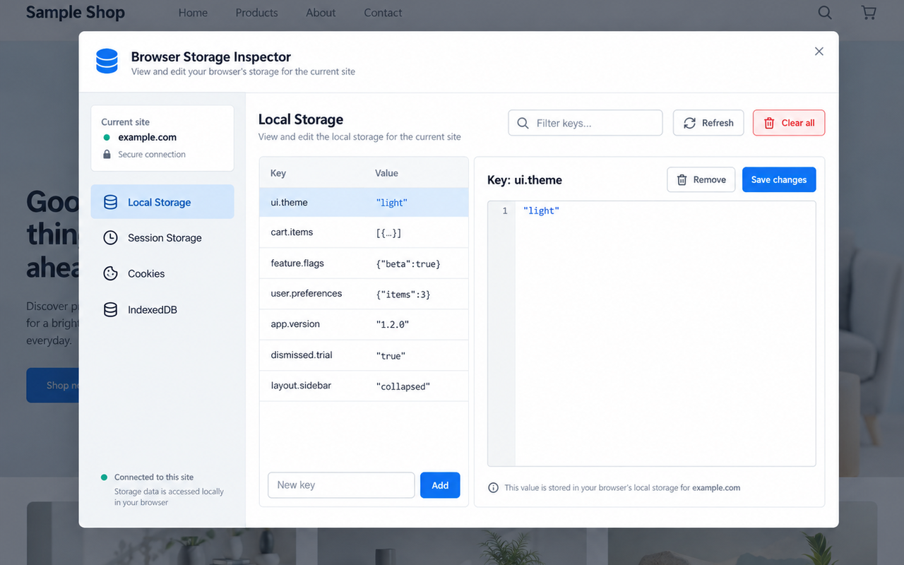

# Browser Storage Inspector

一个面向开发者的浏览器扩展，在当前网站中检查和编辑 **Local Storage、Session Storage、Cookie 与 IndexedDB**。点击工具栏扩展图标，或使用 `Alt+W`，即可打开存储面板。



## 商店链接

- [Microsoft Edge Add-ons](https://microsoftedge.microsoft.com/addons/detail/kiikpnkjmmiaoinieohjgkgmmndgkjlp)
- [Chrome Web Store](https://chromewebstore.google.com/detail/empty-title/dlpdpjghidlefnhlmkdobdaghjjnekpn)

## 功能

- **Local Storage / Session Storage**：按键浏览、搜索、新增、编辑和删除数据。
- **Cookie**：通过扩展 API 查看 HttpOnly、Secure、不同路径和分区 Cookie；按域、路径、名称和分区区分同名条目，编辑时保留原属性，支持精确删除和按选定主机清理。
- **IndexedDB**：按数据库和对象仓库分页浏览全部记录（每页 500 条），新增、删除记录，以 JSON 编辑兼容值；Date、Blob、Map、循环引用等非 JSON 值只读，避免保存时损坏。支持 Date、二进制和复合主键，编辑时禁止意外修改主键。
- **确认后清理**：可清空当前站点的 Local Storage、Session Storage、匹配选定主机的 Cookie，或所有 IndexedDB 记录；每项操作都会先显示确认提示。
- **快速查找**：搜索 Storage 键名、Cookie 名称和 IndexedDB 主键。
- **JSON 预览**：可解析为 JSON 的 Storage 值可切换格式化预览；预览为只读，不会改写原始值。

### 使用范围

扩展面板运行在隔离世界，使用封闭 Shadow DOM 隔离样式与界面；不再向网页主世界注入管理脚本或开放特权事件桥。Cookie 通过后台扩展 API 处理，网页不能直接调用该管理接口。最低支持 Chrome / Edge 132。

### 多域名、iframe 与数据范围

面板顶部的 **FRAME / ORIGIN** 选择器列出当前标签页的 HTTP(S) 顶层页面和 iframe；选择后，所有数据操作都绑定该 frame。新增或导航后的 iframe 可点击 **Reload frames** 更新列表。切换前会提示放弃未保存的修改；frame 已跨 origin 导航时，旧请求会被拒绝，防止误写其他站点。

| 数据 | 隔离与操作范围 |
| --- | --- |
| Local Storage / IndexedDB | 按 origin（协议、主机、端口）和浏览器存储分区隔离；在选定 frame 的实际上下文执行 |
| Session Storage | 在选定标签页、frame 的实际会话上下文执行，同 origin 的其他标签页不会被清理 |
| Cookie | 按主机匹配 host-only 与适用的父域 Cookie，不限制当前 URL 路径；显示所有可访问分区，并保留 storeId、partitionKey |

例如，`app.example.com`、`api.example.com`、`https://app.example.com:8443` 的 Web Storage 分开管理。`.example.com` Cookie 可以被多个子域共享，修改或清理它会影响其他适用子域；确认框会明确提示这一点。Cookie 不按端口隔离。隐私窗口使用该标签页对应的 Cookie store，需要在浏览器设置中允许扩展在隐私窗口运行。

当前标签页没有加载的域名，请打开目标网站的标签页后操作；不会扫描或清理全部浏览器域名。受限浏览器页面、没有授权的网站，以及浏览器未提供可注入上下文的 frame 无法访问。浏览器的第三方存储限制仍然有效，不会绕过存储分区。`about:blank`、`srcdoc`、`data:` 等非 HTTP(S) frame 暂不列入选择器。

Cookie 值保持原始编码，不自动 URI 解码。新增 Cookie 使用选定 frame 的主机和指定路径；编辑已有 Cookie 保留 domain、path、HttpOnly、Secure、SameSite、过期时间及分区。清理只删除已显示范围中的匹配项；跨多个数据库或 Cookie 的批量清理不具备整体回滚能力，失败时可能已清理部分数据。IndexedDB 搜索作用于当前页，使用 Previous / Next 500 浏览后续记录。

## Privacy

扩展在当前网页上下文中读取和写入网站存储，不会将这些数据发送给开发者或开发者运营的服务器。完整说明见[隐私政策](PRIVACY.md)。

## Logo 与扩展图标

新版 Logo 使用深蓝底色、白色存储堆栈和浅蓝色放大镜。扩展工具栏提供 16 / 24 / 32 px 图标，扩展管理页提供 48 / 64 / 128 px 图标，面板内品牌标志与四类存储导航图标也已统一更新。


原始设计稿、尺寸说明与生成提示词见 [Logo 资源说明](media/brand/README.md)。

## 浏览器宣传图

### Microsoft Edge



### Google Chrome


Chrome 商店素材独立放在 `media/chrome/`：功能界面图 `screenshot-1.png`（1280 × 800）、小型宣传图 `promo-small.png`（440 × 280）、顶部宣传图 `promo-top.png`（1400 × 560）和图标 `icon-128.png`。界面图使用虚构示例数据。Edge 商店素材保留在 `media/` 根目录：`edge-promo-small.png`（440 × 280）与 `edge-promo-large.png`（1400 × 560）。

Edge 商店图标：`media/300.png`（300 × 300）。商店截图：`media/edge-screenshot.png`（1280 × 800）。



## 安装与开发

需要 Node.js `20.19` 或更新版本，以及 pnpm `12`。

```sh
pnpm install
pnpm dev
pnpm build
pnpm test
```

`pnpm dev` 用于界面开发预览；真实存储操作需要在加载后的扩展中验证。构建后，在 Chrome 或 Edge 的扩展管理页面打开**开发者模式**，选择**加载解压缩的扩展**，并选择 `packages/shell-chrome/build` 目录。

## 浏览器回归验证

`tests/browser.mjs` 使用 Playwright 启动独立的临时 Chromium 配置和本地 HTTPS 虚构数据站点，覆盖严格 CSP、面板重开、HttpOnly / Path / 分区 Cookie、跨域 frame、写回和 IndexedDB 主键 / 分页。不会读取日常浏览器配置。

```sh
pnpm build
# 需要 openssl；首次运行安装测试浏览器
pnpm exec playwright install chromium
pnpm test:browser
# 使用已有 Playwright 安装时，可通过 PLAYWRIGHT_MODULE 指定其绝对模块路径
```

`cookies` 权限用于完整 Cookie 管理，`webNavigation` 用于枚举当前标签页的 frame。更新已有扩展后可能需要重新确认新增权限并刷新目标网页。

## License

[MIT](LICENSE)
